# BORROWCIRCLE
# SYSTEM ARCHITECTURE DOCUMENT

Version: 1.0  
Document Type: Software Architecture Document  
Product: BorrowCircle  
Architecture Style: Modular Monolith with Shared REST API  
Platforms: Web, Android, iOS  
Database: PostgreSQL  
Backend: Next.js  
ORM: Prisma  
Authentication: Supabase Auth  
Status: Architecture Specification

---

# 1. INTRODUCTION

## 1.1 Purpose

This document defines the overall software architecture of BorrowCircle.

It describes how the website, mobile applications, backend services, database, authentication system, storage providers and external integrations interact.

The purpose is to establish a scalable, secure and maintainable foundation for development.

## 1.2 Product Overview

BorrowCircle is a hyperlocal peer-to-peer borrowing and lending platform.

Users can:

- Create accounts.
- List items they own.
- Discover items nearby.
- Request items for specific dates.
- Accept or decline borrowing requests.
- Acknowledge digital agreements.
- Document item conditions.
- Track active borrowings.
- Confirm returns.
- Review other users.

The platform supports:

1. Responsive web application.
2. Android application.
3. iOS application.
4. Shared backend.
5. Central database.
6. Shared authentication.
7. Common transaction and business logic.

## 1.3 Architectural Goals

The architecture must:

- Maintain a single source of truth.
- Support multiple frontend platforms.
- Prevent duplicate business logic.
- Maintain transaction consistency.
- Protect user information.
- Support location-based discovery.
- Handle concurrent borrowing requests.
- Support future integrations.
- Remain easy to develop and maintain.
- Avoid unnecessary architectural complexity.

---

# 2. ARCHITECTURAL STYLE

## 2.1 Recommended Architecture

BorrowCircle will initially use a **Modular Monolithic Architecture**.

The backend will be deployed as one application but divided into clearly separated functional modules.

Each module will have defined responsibilities and interfaces.

This approach is preferable for the initial product because it:

- Reduces deployment complexity.
- Makes local development easier.
- Simplifies debugging.
- Avoids unnecessary microservice infrastructure.
- Supports rapid MVP development.
- Allows future extraction of independent services.

The architecture must maintain clear module boundaries so individual components can be separated later if the platform grows.

## 2.2 Core Architectural Principle

ONE SHARED BACKEND  
ONE CENTRAL DATABASE  
ONE AUTHENTICATION SYSTEM  
ONE TRANSACTION ENGINE  
THREE CLIENT PLATFORMS

The website and mobile applications are independent clients of the same backend.

Neither frontend is allowed to directly modify database records.

All important business operations must pass through backend services.

---

# 3. HIGH-LEVEL SYSTEM ARCHITECTURE

## 3.1 System Overview

The system consists of the following major components:

1. Web Client.
2. Mobile Client.
3. API Layer.
4. Authentication Layer.
5. Application Service Layer.
6. Database Layer.
7. File Storage Layer.
8. Notification Layer.
9. Background Job Layer.
10. External Integration Layer.

## 3.2 Architecture Diagram

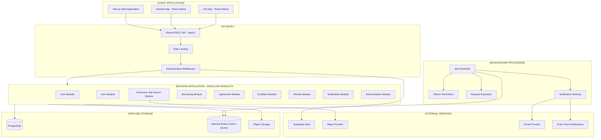

## 3.3 Component Responsibilities

### Client Applications

Provide the user interface and collect user input.

### API Layer

Receives requests and provides a consistent interface for all clients.

### Authentication Layer

Validates user identity and access permissions.

### Application Services

Execute business logic and coordinate operations.

### Database

Stores users, listings, requests, agreements and transaction records.

### Object Storage

Stores listing photographs and condition evidence.

### Background Processing

Handles scheduled and asynchronous operations.

### External Integrations

Provide authentication, maps, email and push notification services.

---

# 4. CLIENT ARCHITECTURE

## 4.1 Web Application

Technology:

- Next.js.
- TypeScript.
- App Router.
- Tailwind CSS.
- React.
- TanStack Query.
- React Hook Form.
- Zod.

The web application is responsible for rendering the complete BorrowCircle experience in browsers.

### Web Modules

```text
apps/web/
│
├── app/
│   ├── (public)/
│   │   ├── page.tsx
│   │   ├── about/
│   │   └── how-it-works/
│   │
│   ├── (auth)/
│   │   ├── login/
│   │   ├── signup/
│   │   └── forgot-password/
│   │
│   ├── discover/
│   ├── items/
│   ├── dashboard/
│   ├── requests/
│   ├── borrowings/
│   ├── notifications/
│   ├── profile/
│   ├── settings/
│   └── admin/
│
├── components/
├── features/
├── hooks/
├── services/
├── lib/
├── types/
└── styles/
```

### Web Responsibilities

- Render public pages.
- Manage authentication UI.
- Display listings.
- Handle search and filtering.
- Create and edit listings.
- Submit borrowing requests.
- Display agreements.
- Handle condition documentation.
- Display transaction history.
- Manage user profiles.
- Provide administration interfaces.

### Web Rules

1. Never access PostgreSQL directly from browser code.
2. Never expose private environment variables.
3. Never trust client-side transaction statuses.
4. Validate form input before submission.
5. Treat backend responses as authoritative.
6. Protect private pages using authentication.
7. Enforce permissions again on the backend.

---

## 4.2 Mobile Application

Technology:

- React Native.
- Expo.
- TypeScript.
- Expo Router.
- TanStack Query.
- Expo SecureStore.
- Expo Notifications.

The mobile application will provide native-feeling experiences for Android and iOS.

### Mobile Modules

```text
apps/mobile/
│
├── app/
│   ├── (onboarding)/
│   ├── (auth)/
│   ├── (tabs)/
│   │   ├── index.tsx
│   │   ├── discover.tsx
│   │   ├── activity.tsx
│   │   ├── saved.tsx
│   │   └── profile.tsx
│   │
│   ├── items/
│   ├── requests/
│   ├── borrowings/
│   ├── notifications/
│   └── settings/
│
├── components/
├── features/
├── hooks/
├── services/
├── utils/
├── constants/
└── assets/
```

### Mobile Responsibilities

- Onboarding.
- Login and registration.
- Nearby discovery.
- Item browsing.
- Image capture.
- Image uploads.
- Borrowing requests.
- Agreement acknowledgement.
- Handover and return evidence.
- Push notifications.
- Profile management.

### Mobile-Specific Requirements

- Secure authentication storage.
- Camera and photo library permissions.
- Location permissions.
- Push notification registration.
- Deep linking.
- Safe-area handling.
- Network failure handling.

The mobile application must use the same API contracts as the website.

---

# 5. BACKEND ARCHITECTURE

## 5.1 Backend Structure

The backend will use Next.js Route Handlers initially.

API Base Path:

`/api/v1`

The backend will follow a layered architecture.

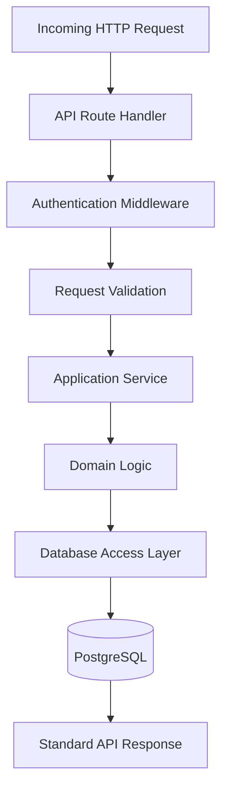

## 5.2 API Layer

Responsibilities:

- Receive requests.
- Validate route parameters.
- Validate authentication.
- Call appropriate service.
- Return standard responses.
- Handle exceptions.

API handlers should remain thin.

Avoid placing large business logic functions inside route files.

## 5.3 Service Layer

The service layer contains application-specific business operations.

Examples:

- CreateListingService.
- SearchItemsService.
- CreateBorrowRequestService.
- AcceptBorrowRequestService.
- AgreementService.
- ConditionReportService.
- ReturnService.
- ReviewService.
- NotificationService.

Services coordinate domain rules and database operations.

## 5.4 Domain Layer

The domain layer defines the core business rules.

Important domain concepts:

- User.
- Listing.
- Availability.
- Borrowing Request.
- Agreement.
- Condition Report.
- Transaction.
- Review.

Domain logic should not depend on React components or UI state.

## 5.5 Repository / Data Access Layer

Responsibilities:

- Database queries.
- Record creation.
- Record updates.
- Relationship loading.
- Transaction execution.
- Data filtering.

Use Prisma as the ORM.

---

# 6. BACKEND MODULES

## 6.1 Authentication Module

Responsibilities:

- Validate Supabase access tokens.
- Resolve BorrowCircle user records.
- Manage authentication-related account operations.
- Protect private endpoints.

Supabase Auth is the authentication provider.

BorrowCircle PostgreSQL stores the application's user profile and business information.

## 6.2 User Module

Responsibilities:

- Create user profiles.
- Retrieve user profiles.
- Update profile details.
- Manage account status.
- Retrieve reviews.
- Manage user blocks.
- Handle user reports.

## 6.3 Item Module

Responsibilities:

- Create listings.
- Update listings.
- Remove listings.
- Retrieve listings.
- Manage images.
- Manage item categories.
- Manage availability.

## 6.4 Discovery Module

Responsibilities:

- Search items.
- Filter by category.
- Filter by distance.
- Sort results.
- Retrieve nearby listings.
- Support map-based discovery.

Search must respect listing status and privacy rules.

## 6.5 Borrowing Module

This is the most important backend module.

Responsibilities:

- Create requests.
- Retrieve sent requests.
- Retrieve received requests.
- Accept requests.
- Decline requests.
- Cancel requests.
- Track active borrowings.
- Enforce availability.
- Enforce transaction state transitions.

All critical transaction operations must be server-controlled.

## 6.6 Agreement Module

Responsibilities:

- Generate agreement snapshots.
- Store agreement versions.
- Record borrower acknowledgement.
- Record lender acknowledgement.
- Validate agreement completion.

## 6.7 Condition Module

Responsibilities:

- Record initial condition.
- Store handover photographs.
- Record return condition.
- Store return photographs.
- Maintain evidence history.

## 6.8 Review Module

Responsibilities:

- Create reviews.
- Validate transaction completion.
- Prevent duplicate reviews.
- Retrieve user ratings.
- Calculate average ratings.

## 6.9 Notification Module

Responsibilities:

- Create in-app notifications.
- Send push notifications.
- Send emails.
- Mark notifications as read.
- Retry failed deliveries.

## 6.10 Administration Module

Responsibilities:

- User moderation.
- Listing moderation.
- Report management.
- Dispute review.
- Administrative actions.
- Analytics.
- Audit events.

---

# 7. DATABASE ARCHITECTURE

## 7.1 Database Technology

PostgreSQL is the central data store.

Prisma manages schema definitions, queries and migrations.

## 7.2 Database Entities

Core entities:

```text
USERS
CATEGORIES
ITEMS
ITEM_IMAGES
AVAILABILITY
BORROW_REQUESTS
AGREEMENTS
CONDITION_REPORTS
CONDITION_IMAGES
REVIEWS
NOTIFICATIONS
SAVED_ITEMS
USER_REPORTS
AUDIT_EVENTS
```

Additional entities as required:

```text
USER_BLOCKS
USER_DEVICES
PUSH_TOKENS
DISPUTES
PAYMENT_TRANSACTIONS
REFUNDS
COMMUNITY_GROUPS
COMMUNITY_MEMBERSHIPS
```

## 7.3 Entity Relationship Diagram

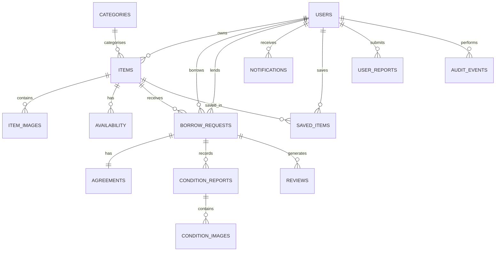

## 7.4 Database Integrity

Enforce:

- Foreign key constraints.
- Unique usernames.
- Unique saved-item combinations.
- Valid review ratings.
- Valid transaction references.
- Unique agreement per borrowing request.
- Valid transaction state transitions.
- No overlapping confirmed reservations.

## 7.5 Database Transactions

Use PostgreSQL transactions for critical operations.

Examples:

- Accepting a borrowing request.
- Confirming a reservation.
- Acknowledging both agreement parties.
- Confirming return.
- Resolving a dispute.

Never perform a critical multi-step transaction through unrelated database writes without transactional protection.

---

# 8. AUTHENTICATION ARCHITECTURE

## 8.1 Authentication Provider

Supabase Auth.

## 8.2 Authentication Flow

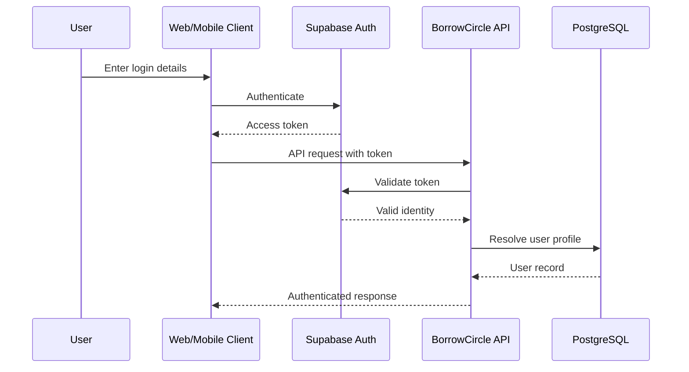

## 8.3 Authentication Rules

- Access tokens must be verified.
- Expired tokens must be rejected or refreshed appropriately.
- Users must be mapped to their BorrowCircle profiles.
- Suspended accounts must be restricted.
- Sensitive operations require authenticated sessions.
- Admin operations require explicit admin permissions.

## 8.4 Token Storage

Web:

Use secure cookie-based session handling where supported by the authentication integration.

Mobile:

Use Expo SecureStore for sensitive credentials.

Never store service-role credentials in frontend applications.

---

# 9. ITEM DISCOVERY ARCHITECTURE

## 9.1 Discovery Inputs

The discovery module receives:

- Search keyword.
- Category.
- Latitude.
- Longitude.
- Search radius.
- Date range.
- Price range.
- Item condition.
- Sorting preference.

## 9.2 Discovery Flow

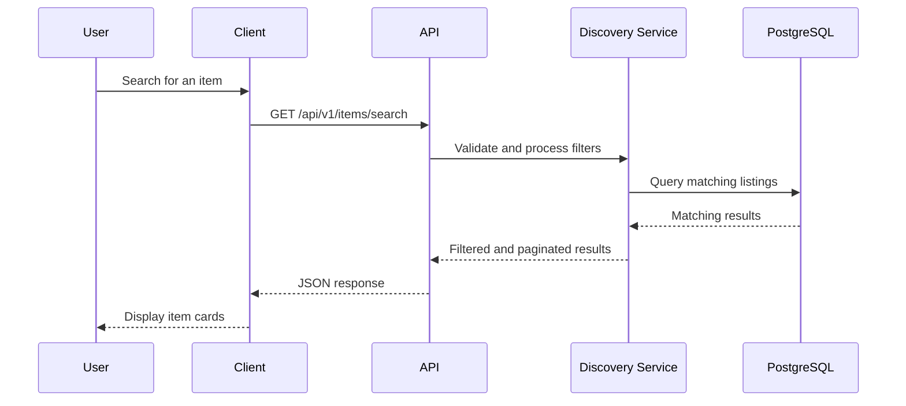

## 9.3 Location Search

Use approximate coordinates for public discovery.

Distance calculation may use:

- Haversine calculation.
- PostgreSQL PostGIS extension.

PostGIS can be introduced when more advanced geospatial queries are needed.

## 9.4 Search Privacy

Never return exact home coordinates through public discovery APIs.

Only return approximate location or general locality.

---

# 10. BORROWING TRANSACTION ARCHITECTURE

## 10.1 Overview

The borrowing module controls the complete lifecycle.

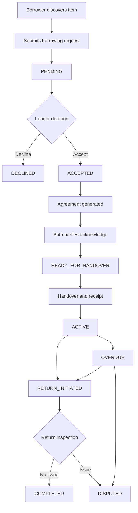

## 10.2 Request Creation

The borrower selects an item and date range.

The backend validates:

- Listing exists.
- Listing is active.
- Borrower is authenticated.
- Borrower is not the owner.
- Dates are valid.
- Borrowing duration is permitted.
- Listing is available.

A new request is created with status:

PENDING

## 10.3 Request Acceptance

The lender accepts the request.

Before acceptance, the backend must recheck availability.

The operation must execute within a safe database transaction.

If a conflict exists, the operation must fail with HTTP 409.

## 10.4 Agreement Creation

Once accepted:

- Generate an agreement snapshot.
- Store agreed terms.
- Store fee and deposit values.
- Record agreement version.
- Await both acknowledgements.

After both acknowledgements:

READY_FOR_HANDOVER

## 10.5 Handover

Record:

- Initial item condition.
- Images.
- Notes.
- Timestamp.
- Borrower receipt confirmation.

After valid receipt confirmation:

ACTIVE

## 10.6 Return

The borrower initiates return.

The lender verifies the returned item.

Both parties can submit return evidence.

If the return is accepted:

COMPLETED

If there is a disagreement:

DISPUTED

## 10.7 State Machine Ownership

The BorrowingStateService is the only normal application service authorised to perform transaction status transitions.

Do not allow frontend clients to directly update status fields.

---

# 11. RESERVATION CONCURRENCY ARCHITECTURE

## 11.1 Problem

Multiple users may request the same item for overlapping dates.

Without concurrency control, two requests could incorrectly be accepted.

## 11.2 Solution

Use database-level and service-level concurrency protection.

Acceptance process:

1. Begin database transaction.
2. Lock the item record or serialise access to its reservation data.
3. Verify the request is still PENDING.
4. Recheck confirmed reservations.
5. Validate availability.
6. Update the request.
7. Commit transaction.

## 11.3 Date Range Rules

Use a consistent half-open interval:

`[start_date, end_date)`

This allows one booking to end on the same date another begins, if the product's handover policy permits it.

The product must explicitly define whether the end date represents the return date.

## 11.4 Database-Level Protection

Where practical, implement PostgreSQL exclusion constraints for overlapping confirmed reservation ranges.

If the chosen schema cannot enforce this directly, use a dedicated reservation table or equivalent transaction-locking strategy.

## 11.5 Conflict Response

Return:

HTTP 409

```json
{
  "success": false,
  "error": {
    "code": "RESERVATION_CONFLICT",
    "message": "The item is no longer available for these dates."
  }
}
```

---

# 12. FILE STORAGE ARCHITECTURE

## 12.1 Storage Provider

Initial options:

- Cloudinary.
- Amazon S3.
- Compatible object storage.

## 12.2 File Categories

1. Listing photographs.
2. User profile images.
3. Handover evidence.
4. Return evidence.

## 12.3 Upload Flow

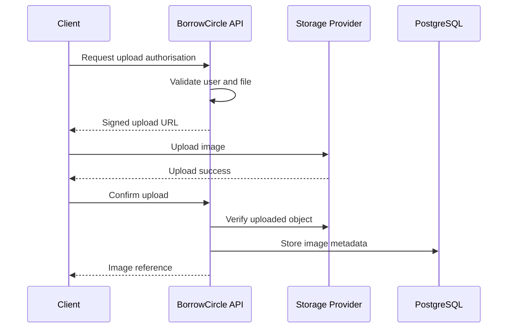

## 12.4 Storage Security

- Listing images may be publicly accessible after publication.
- Condition evidence must use controlled access.
- Upload permissions must be scoped.
- Signed URLs must expire.
- File size and file type must be validated.
- Users must not be able to overwrite another user's images.

---

# 13. NOTIFICATION ARCHITECTURE

## 13.1 Channels

1. In-app notifications.
2. Push notifications.
3. Email notifications.

## 13.2 Notification Events

- New borrowing request.
- Request accepted.
- Request declined.
- Agreement awaiting acknowledgement.
- Agreement completed.
- Handover reminder.
- Borrowing activated.
- Return reminder.
- Return initiated.
- Return completed.
- Borrowing overdue.
- Dispute update.
- New review.

## 13.3 Notification Flow

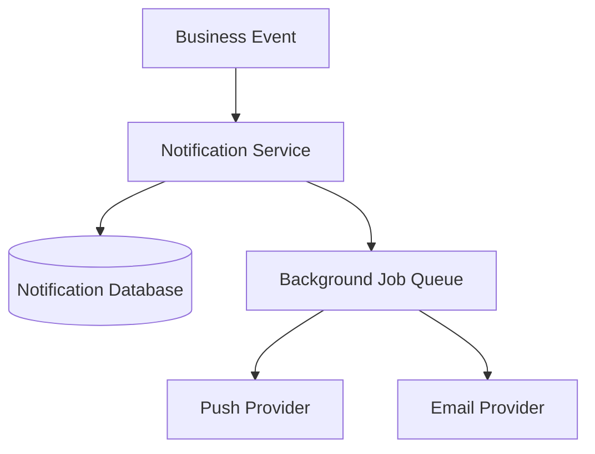

## 13.4 Reliability

Notification delivery must not control transaction success.

If a notification provider is unavailable:

- Store the notification in the database.
- Retry delivery where appropriate.
- Record failures.
- Avoid duplicate delivery.

Use idempotent background jobs.

---

# 14. BACKGROUND PROCESSING ARCHITECTURE

Some operations must happen without an active user request.

Examples:

- Return reminders.
- Overdue detection.
- Request expiration.
- Email delivery.
- Push notification delivery.
- Cleanup of expired temporary upload records.

## 14.1 Recommended Approach

Initially use a managed scheduler or background job provider.

A queue system can be introduced when workload requires it.

Optional infrastructure:

- Redis.
- BullMQ.
- Managed queue service.
- Scheduled serverless functions.

Do not add Redis merely for architectural appearance.

## 14.2 Job Requirements

Every job must:

- Be safe to retry.
- Avoid duplicate operations.
- Log failures.
- Have a defined execution schedule.
- Handle temporary provider failures.

---

# 15. SHARED API CONTRACT ARCHITECTURE

## 15.1 Principle

Both web and mobile must consume the same API definitions.

Create shared packages:

```text
packages/
│
├── api-client/
├── contracts/
├── domain/
├── validation/
├── design-tokens/
└── config/
```

## 15.2 Contracts

The contracts package should define:

- Request types.
- Response types.
- Pagination formats.
- Error structures.
- Transaction status enums.
- Listing status enums.
- Notification types.

## 15.3 Example Transaction Contract

```typescript
export type BorrowingStatus =
  | "PENDING"
  | "ACCEPTED"
  | "AWAITING_ACKNOWLEDGEMENT"
  | "READY_FOR_HANDOVER"
  | "ACTIVE"
  | "RETURN_INITIATED"
  | "OVERDUE"
  | "DISPUTED"
  | "COMPLETED"
  | "DECLINED"
  | "CANCELLED"
  | "EXPIRED";
```

## 15.4 API Versioning

Use:

`/api/v1`

Future breaking changes should be introduced through a controlled versioning strategy.

Avoid breaking existing mobile clients unexpectedly.

---

# 16. SECURITY ARCHITECTURE

## 16.1 Security Boundaries

Treat these as separate trust boundaries:

- Browser and mobile clients.
- API server.
- Authentication provider.
- Database.
- Object storage.
- External integrations.

Never assume client-provided data is trustworthy.

## 16.2 Authentication

- Validate access tokens.
- Check account status.
- Verify permissions.
- Protect sensitive routes.

## 16.3 Authorisation

Check ownership and transaction participation on the backend.

Examples:

- Only an item owner can edit their listing.
- Only a lender can accept a received request.
- Only a borrower can initiate a return.
- Only transaction participants can access private evidence.
- Only administrators can resolve disputes.

## 16.4 Data Privacy

- Do not expose exact addresses publicly.
- Protect phone numbers and emails.
- Use private access for condition evidence.
- Restrict administrative data access.
- Avoid sensitive information in logs.

## 16.5 API Protection

Implement:

- Rate limiting.
- Input validation.
- Secure session handling.
- Request size limits.
- Safe error responses.
- Audit logging.
- Dependency updates.

---

# 17. EXTERNAL SERVICE INTEGRATIONS

## 17.1 Supabase Auth

Purpose:

- User authentication.
- Email verification.
- Password recovery.
- Optional OAuth login.

## 17.2 Maps Provider

Purpose:

- Location selection.
- Map display.
- Nearby discovery.
- Address or locality search.

Possible providers:

- Google Maps.
- OpenStreetMap-based services.

## 17.3 Object Storage

Purpose:

- Listing images.
- Profile images.
- Transaction condition evidence.

## 17.4 Push Notifications

Purpose:

- Transaction updates.
- Return reminders.
- Important account events.

## 17.5 Email Provider

Purpose:

- Account verification.
- Password reset.
- Transaction notifications.

External providers should be accessed through backend integration modules wherever practical.

---

# 18. DEPLOYMENT ARCHITECTURE

## 18.1 Initial Deployment

Recommended setup:

Web:
Vercel.

Backend:
Next.js API deployed with the web application initially.

Database:
Managed PostgreSQL.

Authentication:
Supabase Auth.

Storage:
Cloudinary or S3-compatible storage.

Mobile:
Expo EAS Build and EAS Submit.

## 18.2 Deployment Diagram

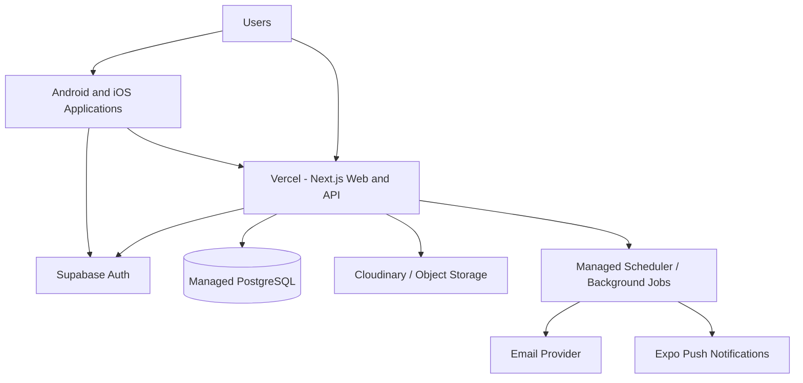

## 18.3 Environments

Maintain separate environments:

- Development.
- Testing.
- Staging.
- Production.

Production data must not be used casually in development.

## 18.4 CI/CD

Every change should pass:

- Linting.
- TypeScript checks.
- Unit tests.
- Integration tests.
- Build checks.
- Security checks where configured.

Deploy through controlled pipelines.

---

# 19. OBSERVABILITY AND MONITORING

Monitor the following:

## Backend

- API response time.
- API failure rate.
- Authentication failures.
- Reservation conflicts.
- Database query performance.
- Background job failures.

## Web

- JavaScript errors.
- Page loading.
- API failures.
- Navigation failures.

## Mobile

- Application crashes.
- Failed API calls.
- Push notification failures.
- Upload failures.

## Database

- Connection usage.
- Slow queries.
- Storage usage.
- Backup status.
- Migration failures.

Use structured logs and error monitoring.

Do not log passwords, access tokens or unnecessary personal information.

---

# 20. SCALABILITY STRATEGY

## 20.1 Initial Stage

Use:

- One modular backend.
- One PostgreSQL database.
- Managed object storage.
- Managed authentication.
- Background jobs as required.

## 20.2 Growth Stage

As traffic increases:

- Add database indexes.
- Optimise queries.
- Introduce caching where useful.
- Add a dedicated search solution if required.
- Introduce queue-based processing.
- Improve image delivery.
- Separate heavy background workloads.

## 20.3 Advanced Stage

If individual modules become bottlenecks, consider extracting:

- Search service.
- Notification service.
- Media processing service.
- Analytics service.

Do not move to microservices until measurable operational or scaling requirements justify the additional complexity.

---

# 21. CROSS-PLATFORM DATA FLOW

This is a fundamental architectural requirement.

Example:

A user creates an item listing using the website.

The web client sends the request to the shared API.

The API stores the listing in PostgreSQL.

The mobile application requests the user's nearby listings.

The API retrieves the same record.

The mobile application displays the newly created item.

The same principle applies to:

- Borrowing requests.
- Agreement acknowledgement.
- Transaction status.
- Condition reports.
- Notifications.
- Reviews.
- Profile updates.

No platform-specific duplicate transaction records are allowed.

---

# 22. CRITICAL SYSTEM FLOWS

## 22.1 Listing Creation

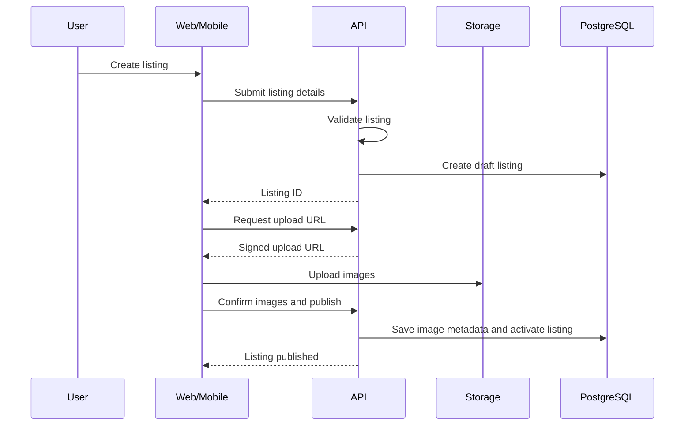

## 22.2 Borrowing Request

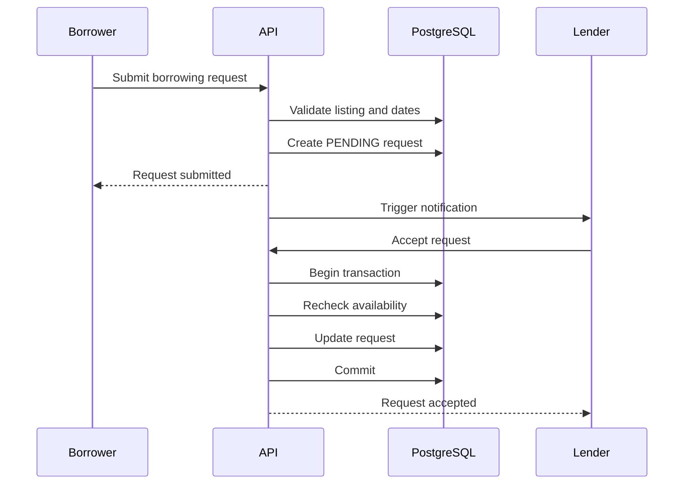

## 22.3 Agreement Acknowledgement

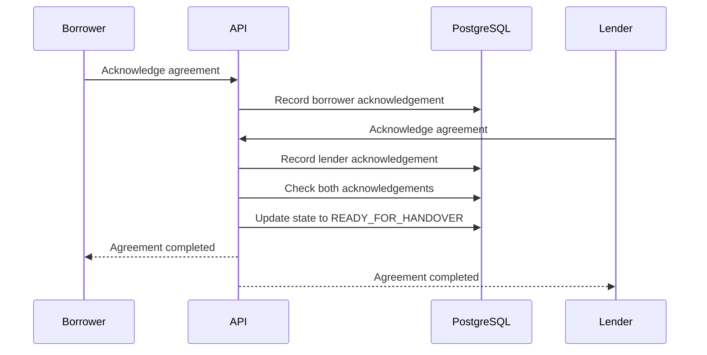

## 22.4 Return Confirmation

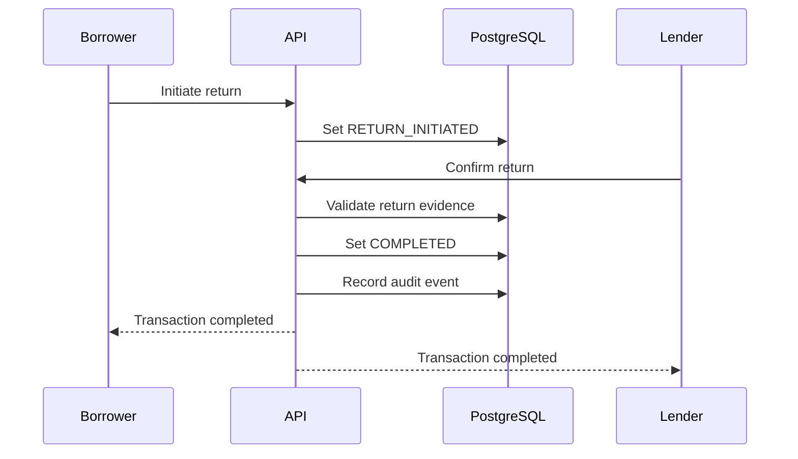

---

# 23. FAILURE HANDLING AND RECOVERY

The architecture must handle:

- Database unavailable.
- Authentication provider unavailable.
- Image upload failure.
- Push notification failure.
- Email delivery failure.
- Network interruption.
- Duplicate requests.
- Concurrent reservations.
- Invalid transaction transitions.

## Recovery Principles

1. Do not report success before the database operation succeeds.
2. Retry only operations that are safe to retry.
3. Use idempotency for critical mutations.
4. Preserve transaction consistency.
5. Log important failures.
6. Keep user-facing error messages understandable.
7. Avoid exposing internal implementation details.
8. Maintain recoverable database backups.

---

# 24. ARCHITECTURAL DECISIONS

| Decision | Selected Approach | Reason |
|---|---|---|
| Backend | Next.js API | Shared web and mobile API |
| Architecture | Modular monolith | Simpler MVP operations |
| Web | Next.js | Responsive full web application |
| Mobile | React Native + Expo | Shared Android/iOS implementation |
| Language | TypeScript | Consistent typing |
| Database | PostgreSQL | Relational integrity |
| ORM | Prisma | Type-safe database access |
| Authentication | Supabase Auth | Managed authentication |
| API | REST | Straightforward client integration |
| Storage | Cloudinary/S3 | Scalable image storage |
| Notifications | Expo + Email | Cross-platform delivery |
| Deployment | Vercel + Managed Services | Reduced infrastructure overhead |

---

# 25. ARCHITECTURAL RISKS

## 25.1 Reservation Conflicts

Risk:
Two borrowers may request overlapping dates.

Mitigation:
Transactional acceptance and database-level concurrency protection.

## 25.2 Location Privacy

Risk:
Exact user locations may be exposed.

Mitigation:
Approximate public coordinates and access-controlled handover details.

## 25.3 Cross-Platform Inconsistency

Risk:
Web and mobile may display outdated transaction states.

Mitigation:
Shared backend, shared API contracts and appropriate cache invalidation.

## 25.4 External Service Failure

Risk:
Authentication, maps or notification providers may become unavailable.

Mitigation:
Graceful degradation, retries and provider abstraction.

## 25.5 Database Growth

Risk:
Listings, images and transaction history may grow substantially.

Mitigation:
Pagination, indexing, retention policies and storage separation.

## 25.6 Premature Complexity

Risk:
Introducing microservices, queues and caches too early.

Mitigation:
Start with a modular monolith and introduce infrastructure based on measured needs.

---

# 26. ARCHITECTURAL ACCEPTANCE CRITERIA

The architecture is considered correctly implemented when:

1. Website and mobile applications use one backend.
2. All platforms share one database.
3. Authentication works across platforms.
4. Business rules exist on the backend.
5. API contracts are shared.
6. Listings synchronise across platforms.
7. Borrowing requests synchronise across platforms.
8. Concurrent reservations are handled safely.
9. Transaction state changes are validated.
10. Agreements are stored as snapshots.
11. Condition evidence is protected.
12. Exact locations are not publicly exposed.
13. Notifications are reliably persisted.
14. Administrative access is restricted.
15. Database migrations are controlled.
16. Critical operations have automated tests.
17. Production secrets are protected.
18. Monitoring and backups are configured.

---

# 27. FINAL ARCHITECTURAL PRINCIPLE

BorrowCircle should be developed as one unified ecosystem rather than three independent applications.

The website, Android application and iOS application are separate user interfaces connected to one shared platform.

PostgreSQL remains the central source of truth.

The backend remains the authority for business logic, permissions, availability and transaction state.

Every architectural decision should prioritise:

- Simplicity.
- Reliability.
- Security.
- Consistency.
- Maintainability.
- Scalability.

Build the MVP with a clean modular architecture, then expand the system as actual user requirements and platform usage grow.

END OF ARCHITECTURE DOCUMENT
