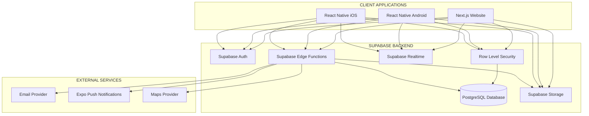
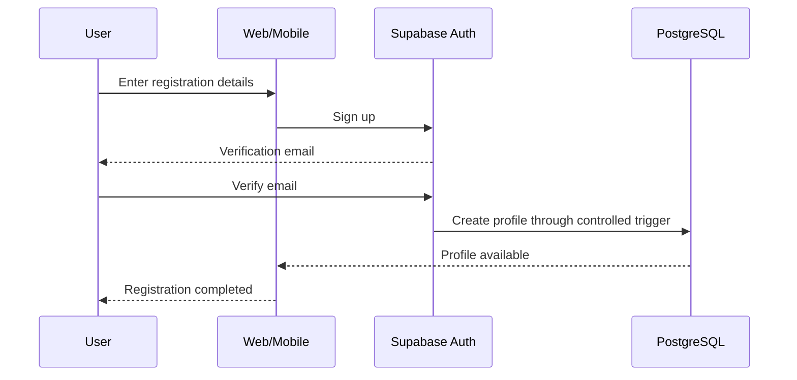

# BORROWCIRCLE
# BACKEND REQUIREMENTS & IMPLEMENTATION DOCUMENT

**File:** BACKEND.md  
**Version:** 1.0  
**Backend Platform:** Supabase  
**Database:** PostgreSQL  
**Authentication:** Supabase Auth  
**Storage:** Supabase Storage  
**Realtime:** Supabase Realtime  
**Serverless Functions:** Supabase Edge Functions  
**Frontend:** Next.js + TypeScript / React Native + Expo + TypeScript  
**Status:** Backend Implementation Specification

---

# 1. BACKEND OVERVIEW

## 1.1 Purpose

This document defines the complete backend architecture and implementation requirements for BorrowCircle using Supabase.

BorrowCircle is a hyperlocal peer-to-peer borrowing and lending platform.

Users can list their belongings, discover items nearby, request borrowing periods, accept requests, acknowledge agreements, document item conditions and complete returns.

The backend must provide a secure and consistent system for all application operations.

## 1.2 Core Architecture

Use one Supabase project for all three client platforms.

- Next.js website.
- Android application.
- iOS application.

All platforms must share the same:

- Authentication system.
- PostgreSQL database.
- Storage buckets.
- Realtime infrastructure.
- Business rules.
- User records.
- Borrowing transactions.

**Important architectural principle:**

Supabase will act as the primary backend infrastructure, while Edge Functions and PostgreSQL functions will handle sensitive business operations.

Do not create separate databases or independent authentication systems for web and mobile.

---

# 2. SUPABASE SERVICES

Use the following Supabase services.

| Supabase Service | BorrowCircle Usage |
|---|---|
| Supabase Auth | Registration, login, sessions |
| PostgreSQL | Users, listings, transactions |
| Row Level Security | Database access control |
| Supabase Storage | Images and condition evidence |
| Supabase Realtime | Live request and notification updates |
| Edge Functions | Secure business operations |
| Database Functions | Transactional business logic |
| Database Triggers | Controlled automated database actions |
| Supabase CLI | Local development and migrations |

## 2.1 Supabase Project

Create one primary Supabase project.

Project name:

borrowcircle-production

Maintain separate projects or isolated environments for:

- Development.
- Staging.
- Production.

Never use production credentials or sensitive production data in local development.

## 2.2 Supabase Dashboard Configuration

Configure:

1. Project URL.
2. Anon/publishable key.
3. Database connection.
4. Authentication providers.
5. Storage buckets.
6. Row Level Security.
7. Realtime publication.
8. Edge Functions.
9. Database backups.
10. Authentication redirect URLs.

Use the current Supabase project key conventions.

The publishable key can be used by frontend applications when database access is protected by RLS.

The secret/service-role key must only be used in trusted server environments.

Never expose secret keys in browser code or mobile application builds.

---

# 3. BACKEND ARCHITECTURE

## 3.1 High-Level Architecture



## 3.2 Architecture Responsibilities

### Frontend Applications

Responsible for:

- Rendering the interface.
- Collecting user input.
- Displaying data.
- Uploading authorised files.
- Calling backend functions.
- Subscribing to authorised realtime events.

### Supabase Auth

Responsible for:

- User registration.
- Login.
- Logout.
- Email verification.
- Password recovery.
- Session management.
- Authentication tokens.

### PostgreSQL

Responsible for:

- User profiles.
- Categories.
- Listings.
- Availability.
- Borrowing requests.
- Agreements.
- Condition reports.
- Reviews.
- Notifications.
- Reports.

### Row Level Security

Responsible for enforcing who can access or modify each database record.

### Edge Functions

Responsible for sensitive application operations.

Examples:

- Accept borrowing request.
- Create borrowing request.
- Acknowledge agreement.
- Confirm receipt.
- Initiate return.
- Confirm return.
- Resolve dispute.
- Send notifications.

### Storage

Responsible for item photographs, profile pictures and transaction evidence.

### Realtime

Responsible for delivering authorised updates to connected clients.

---

# 4. PROJECT STRUCTURE

Organise the project as a monorepo.

```text
borrowcircle/
│
├── apps/
│   │
│   ├── web/
│   │   ├── app/
│   │   ├── components/
│   │   ├── features/
│   │   ├── hooks/
│   │   ├── services/
│   │   ├── lib/
│   │   └── package.json
│   │
│   └── mobile/
│       ├── app/
│       ├── components/
│       ├── features/
│       ├── hooks/
│       ├── services/
│       ├── utils/
│       └── package.json
│
├── packages/
│   ├── supabase/
│   │   ├── client.ts
│   │   ├── types.ts
│   │   └── database.types.ts
│   │
│   ├── contracts/
│   ├── domain/
│   ├── validation/
│   ├── api-client/
│   └── design-tokens/
│
├── supabase/
│   ├── config.toml
│   │
│   ├── migrations/
│   │   ├── 001_initial_schema.sql
│   │   ├── 002_indexes.sql
│   │   ├── 003_rls_policies.sql
│   │   ├── 004_database_functions.sql
│   │   ├── 005_triggers.sql
│   │   └── 006_storage_policies.sql
│   │
│   ├── functions/
│   │   ├── create-borrow-request/
│   │   ├── accept-borrow-request/
│   │   ├── decline-borrow-request/
│   │   ├── cancel-borrow-request/
│   │   ├── acknowledge-agreement/
│   │   ├── confirm-receipt/
│   │   ├── initiate-return/
│   │   ├── confirm-return/
│   │   ├── create-condition-report/
│   │   ├── send-notification/
│   │   └── resolve-dispute/
│   │
│   ├── seed.sql
│   └── tests/
│
├── docs/
│   ├── PRD.md
│   ├── TRD.md
│   ├── DESIGN.md
│   ├── ARCHITECTURE.md
│   └── BACKEND.md
│
├── .env.example
├── package.json
├── pnpm-workspace.yaml
└── README.md
```

Keep database migrations inside the Supabase project so schema changes remain version-controlled.

---

# 5. DATABASE SCHEMA

Use PostgreSQL as the central database.

All primary identifiers should use UUIDs.

Use `TIMESTAMPTZ` for timestamps and `DATE` for calendar borrowing dates.

Store monetary values using integer minor units (paise) or an appropriately constrained numeric type. Do not use floating-point values for money.

Use a consistent currency code, initially INR for the Indian pilot.

## 5.1 USER PROFILES

Table:

`public.profiles`

Purpose:

Stores BorrowCircle user profile information associated with Supabase Auth.

Columns:

- id UUID PRIMARY KEY REFERENCES auth.users(id)
- full_name TEXT NOT NULL
- username TEXT UNIQUE
- email TEXT
- phone TEXT
- bio TEXT
- avatar_path TEXT
- city TEXT
- locality TEXT
- latitude DOUBLE PRECISION
- longitude DOUBLE PRECISION
- is_verified BOOLEAN DEFAULT FALSE
- account_status TEXT DEFAULT 'ACTIVE'
- created_at TIMESTAMPTZ
- updated_at TIMESTAMPTZ

Rules:

- Profile ID must match the Supabase Auth user ID.
- Users can update only permitted profile fields.
- Users cannot grant themselves verification.
- Users cannot grant themselves administrator privileges.
- Private account information must not be exposed publicly.

Do not expose exact coordinates through public profile queries.

## 5.2 CATEGORIES

Table:

`public.categories`

Columns:

- id UUID PRIMARY KEY
- name TEXT UNIQUE NOT NULL
- slug TEXT UNIQUE NOT NULL
- description TEXT
- icon TEXT
- is_active BOOLEAN DEFAULT TRUE
- created_at TIMESTAMPTZ

Initial categories:

- Electronics.
- Photography.
- Tools and Hardware.
- Books and Study Material.
- Sports and Fitness.
- Travel and Luggage.
- Home Appliances.
- Kitchen Equipment.
- Gaming.
- Events and Entertainment.
- Furniture.
- Miscellaneous.

## 5.3 ITEMS

Table:

`public.items`

Columns:

- id UUID PRIMARY KEY
- owner_id UUID REFERENCES public.profiles(id)
- category_id UUID REFERENCES public.categories(id)
- title TEXT NOT NULL
- description TEXT NOT NULL
- condition TEXT NOT NULL
- borrowing_fee BIGINT DEFAULT 0
- security_deposit BIGINT DEFAULT 0
- currency TEXT DEFAULT 'INR'
- minimum_days INTEGER DEFAULT 1
- maximum_days INTEGER
- location_label TEXT
- approximate_latitude DOUBLE PRECISION
- approximate_longitude DOUBLE PRECISION
- status TEXT DEFAULT 'DRAFT'
- created_at TIMESTAMPTZ
- updated_at TIMESTAMPTZ

Listing statuses:

- DRAFT
- ACTIVE
- PAUSED
- UNAVAILABLE
- REMOVED

Rules:

- Owner ID must reference a valid profile.
- Users cannot create listings for another owner.
- Borrowing fees cannot be negative.
- Security deposits cannot be negative.
- Minimum duration must be positive.
- Maximum duration cannot be smaller than minimum duration.
- Only active listings should appear in public discovery.

## 5.4 ITEM IMAGES

Table:

`public.item_images`

Columns:

- id UUID PRIMARY KEY
- item_id UUID REFERENCES public.items(id)
- storage_path TEXT NOT NULL
- display_order INTEGER DEFAULT 0
- created_at TIMESTAMPTZ

Store storage paths rather than relying on permanent public URLs.

## 5.5 AVAILABILITY

Table:

`public.item_availability`

Columns:

- id UUID PRIMARY KEY
- item_id UUID REFERENCES public.items(id)
- start_date DATE NOT NULL
- end_date DATE NOT NULL
- is_available BOOLEAN DEFAULT TRUE
- created_at TIMESTAMPTZ
- updated_at TIMESTAMPTZ

Use a consistent date-range convention across the application.

Recommended convention:

`[start_date, end_date)`

This represents a start-inclusive, end-exclusive interval.

## 5.6 BORROW REQUESTS

Table:

`public.borrow_requests`

Columns:

- id UUID PRIMARY KEY
- item_id UUID REFERENCES public.items(id)
- borrower_id UUID REFERENCES public.profiles(id)
- lender_id UUID REFERENCES public.profiles(id)
- start_date DATE NOT NULL
- end_date DATE NOT NULL
- message TEXT
- borrowing_fee BIGINT DEFAULT 0
- security_deposit BIGINT DEFAULT 0
- currency TEXT DEFAULT 'INR'
- status TEXT DEFAULT 'PENDING'
- created_at TIMESTAMPTZ
- updated_at TIMESTAMPTZ

Important:

The borrowing fee and security deposit must be saved as transaction snapshots.

Later listing changes must not alter an existing accepted transaction.

Rules:

- Borrower cannot equal lender.
- Borrower cannot borrow their own item.
- End date must be later than start date.
- Only valid transaction transitions are allowed.
- Only authorised participants can access transaction details.

## 5.7 AGREEMENTS

Table:

`public.agreements`

Columns:

- id UUID PRIMARY KEY
- borrow_request_id UUID UNIQUE REFERENCES public.borrow_requests(id)
- version INTEGER NOT NULL
- agreement_content JSONB NOT NULL
- borrower_accepted_at TIMESTAMPTZ
- lender_accepted_at TIMESTAMPTZ
- created_at TIMESTAMPTZ

Rules:

- Agreement content must be a snapshot.
- Both parties must acknowledge the same version.
- Acknowledgements must be recorded server-side.
- Any change to agreed terms requires a new version and fresh acknowledgement.

## 5.8 CONDITION REPORTS

Table:

`public.condition_reports`

Columns:

- id UUID PRIMARY KEY
- borrow_request_id UUID REFERENCES public.borrow_requests(id)
- submitted_by UUID REFERENCES public.profiles(id)
- report_type TEXT NOT NULL
- notes TEXT
- created_at TIMESTAMPTZ

Report types:

- HANDOVER
- RETURN

## 5.9 CONDITION IMAGES

Table:

`public.condition_images`

Columns:

- id UUID PRIMARY KEY
- condition_report_id UUID REFERENCES public.condition_reports(id)
- storage_path TEXT NOT NULL
- created_at TIMESTAMPTZ

Condition evidence must use private storage access.

## 5.10 REVIEWS

Table:

`public.reviews`

Columns:

- id UUID PRIMARY KEY
- borrow_request_id UUID REFERENCES public.borrow_requests(id)
- reviewer_id UUID REFERENCES public.profiles(id)
- reviewee_id UUID REFERENCES public.profiles(id)
- rating INTEGER NOT NULL
- comment TEXT
- created_at TIMESTAMPTZ

Rules:

- Rating must be between 1 and 5.
- Only completed transactions can be reviewed.
- Reviewer must be a participant.
- A reviewer can submit only one review per transaction.

## 5.11 NOTIFICATIONS

Table:

`public.notifications`

Columns:

- id UUID PRIMARY KEY
- user_id UUID REFERENCES public.profiles(id)
- type TEXT NOT NULL
- title TEXT NOT NULL
- message TEXT NOT NULL
- reference_id UUID
- is_read BOOLEAN DEFAULT FALSE
- created_at TIMESTAMPTZ

Users can only read and update their own notification records.

## 5.12 SAVED ITEMS

Table:

`public.saved_items`

Columns:

- id UUID PRIMARY KEY
- user_id UUID REFERENCES public.profiles(id)
- item_id UUID REFERENCES public.items(id)
- created_at TIMESTAMPTZ

Unique constraint:

`UNIQUE(user_id, item_id)`

## 5.13 USER REPORTS

Table:

`public.user_reports`

Columns:

- id UUID PRIMARY KEY
- reporter_id UUID REFERENCES public.profiles(id)
- reported_user_id UUID REFERENCES public.profiles(id)
- reported_item_id UUID REFERENCES public.items(id)
- reason TEXT NOT NULL
- description TEXT
- status TEXT DEFAULT 'OPEN'
- created_at TIMESTAMPTZ
- updated_at TIMESTAMPTZ

## 5.14 ADDITIONAL TABLES

Add these as features are implemented:

- user_blocks
- user_devices
- push_tokens
- disputes
- payment_transactions
- refunds
- audit_events
- idempotency_keys

All tables must have appropriate foreign keys, constraints, indexes and RLS policies.

---

# 6. DATABASE ENUMS AND VALIDATION

Use PostgreSQL enums or constrained text values for important statuses.

## 6.1 Borrowing Status

```sql
CREATE TYPE public.borrowing_status AS ENUM (
  'PENDING',
  'ACCEPTED',
  'AWAITING_ACKNOWLEDGEMENT',
  'READY_FOR_HANDOVER',
  'ACTIVE',
  'RETURN_INITIATED',
  'OVERDUE',
  'DISPUTED',
  'COMPLETED',
  'DECLINED',
  'CANCELLED',
  'EXPIRED'
);
```

## 6.2 Listing Status

```sql
CREATE TYPE public.listing_status AS ENUM (
  'DRAFT',
  'ACTIVE',
  'PAUSED',
  'UNAVAILABLE',
  'REMOVED'
);
```

## 6.3 Condition Report Type

```sql
CREATE TYPE public.condition_report_type AS ENUM (
  'HANDOVER',
  'RETURN'
);
```

## 6.4 Validation Rules

Apply validation at multiple levels:

1. Frontend validation using Zod.
2. Edge Function validation.
3. PostgreSQL constraints.
4. RLS and database permissions.

Frontend validation improves usability but is never a replacement for backend validation.

---

# 7. ROW LEVEL SECURITY (RLS)

RLS is one of the most important parts of the BorrowCircle backend.

Enable RLS on every application table exposed through the Supabase Data API.

Do not assume that hiding a button in the frontend provides security.

## 7.1 Profiles Policies

Users may:

- View permitted public profile information.
- Read their own complete profile.
- Update their own permitted fields.

Users must not:

- Update another user's profile.
- Set their own verification status.
- Grant themselves admin permissions.
- Change account moderation status.

## 7.2 Items Policies

Users may:

- View active public listings.
- View their own drafts.
- Create their own listings.
- Update their own permitted listings.
- Pause their own listings.

Users must not:

- Edit another user's listing.
- Change the owner ID.
- Manipulate protected listing fields.
- Remove a listing in a way that breaks an active transaction.

## 7.3 Borrow Request Policies

Only the borrower and lender may access a borrowing request.

Users must not:

- Read unrelated private requests.
- Change lender ID.
- Change borrower ID.
- Directly update transaction status.
- Directly accept requests through unrestricted table updates.
- Modify agreed financial snapshots.

Sensitive transaction mutations must go through trusted backend functions.

## 7.4 Agreement Policies

Only transaction participants can read their agreement.

Users must not directly modify:

- Agreement content.
- Agreement version.
- Another user's acknowledgement.
- Protected acknowledgement timestamps.

Acknowledgement should be handled through a trusted function.

## 7.5 Condition Report Policies

Only transaction participants can view condition evidence.

Only authorised participants can submit their permitted evidence.

Storage access must also enforce the same restrictions.

## 7.6 Reviews Policies

Users may view permitted published reviews.

Users may submit reviews only when:

- They participated in the transaction.
- The transaction is COMPLETED.
- They have not already reviewed that transaction.

## 7.7 Notifications Policies

Users can only:

- View their own notifications.
- Mark their own notifications as read.

Users must not access another user's notifications.

## 7.8 Saved Items Policies

Users can only create, view and delete their own saved-item records.

## 7.9 Admin Policies

Admin permissions must be checked through trusted role data.

Do not use user-editable profile fields to determine administrator access.

Create a protected roles table or equivalent trusted role mechanism.

Never allow a client to assign itself an administrator role.

---

# 8. DATABASE FUNCTION AND TRANSACTION ARCHITECTURE

Sensitive operations must execute atomically.

Use PostgreSQL functions for operations that require database-level transactions.

Edge Functions may authenticate the caller, validate input and invoke these functions.

## 8.1 Accept Borrowing Request

Function:

`accept_borrow_request(request_id UUID)`

Expected behaviour:

1. Identify the authenticated caller.
2. Lock the relevant item or reservation records.
3. Verify caller is the lender.
4. Verify request is PENDING.
5. Verify item is active.
6. Validate requested dates.
7. Recheck availability.
8. Check overlapping confirmed reservations.
9. Update request status to ACCEPTED.
10. Create the agreement snapshot.
11. Commit transaction.
12. Return updated request.

If a conflict exists, return an appropriate conflict error.

## 8.2 Create Borrowing Request

Function:

`create_borrow_request(...)`

Expected behaviour:

- Verify authenticated borrower.
- Verify item exists.
- Verify item is active.
- Verify borrower is not the owner.
- Validate dates.
- Validate borrowing duration.
- Capture current fee and deposit.
- Create request with PENDING status.

## 8.3 Acknowledge Agreement

Function:

`acknowledge_agreement(request_id UUID)`

Expected behaviour:

- Identify authenticated user.
- Verify transaction participation.
- Verify agreement exists.
- Verify transaction permits acknowledgement.
- Record the caller's acknowledgement timestamp.
- Check whether both parties acknowledged.
- If both acknowledged, update transaction to READY_FOR_HANDOVER.
- Record an audit event.

## 8.4 Confirm Receipt

Function:

`confirm_item_receipt(request_id UUID)`

Expected behaviour:

- Verify borrower identity.
- Verify status is READY_FOR_HANDOVER.
- Verify required handover evidence or confirmations.
- Record receipt.
- Change status to ACTIVE.
- Record audit event.

## 8.5 Initiate Return

Function:

`initiate_return(request_id UUID)`

Expected behaviour:

- Verify borrower identity.
- Verify transaction is ACTIVE or OVERDUE.
- Change status to RETURN_INITIATED.
- Record timestamp.
- Notify lender.

## 8.6 Confirm Return

Function:

`confirm_item_return(request_id UUID)`

Expected behaviour:

- Verify authorised lender.
- Verify status is RETURN_INITIATED or another explicitly allowed state.
- Verify return evidence requirements.
- Change status to COMPLETED if there is no unresolved issue.
- Record completion timestamp.
- Record audit event.
- Trigger review eligibility.

## 8.7 Function Security

All privileged database functions must:

- Validate the authenticated caller.
- Use a fixed, trusted search path.
- Fully qualify table references.
- Avoid unsafe dynamic SQL.
- Have appropriate EXECUTE grants.
- Never trust user-supplied role or owner identifiers.

Where a function uses `SECURITY DEFINER`, perform explicit permission checks and restrict execution privileges.

---

# 9. BORROWING STATE MACHINE

Use the following lifecycle:

```text
PENDING
   |
   | Lender accepts
   v
ACCEPTED
   |
   v
AWAITING_ACKNOWLEDGEMENT
   |
   | Both parties acknowledge
   v
READY_FOR_HANDOVER
   |
   | Borrower confirms receipt
   v
ACTIVE
   |
   | Borrower initiates return
   v
RETURN_INITIATED
   |
   | Lender confirms return
   v
COMPLETED
```

Additional states:

- DECLINED
- CANCELLED
- EXPIRED
- OVERDUE
- DISPUTED

## 9.1 Transition Rules

PENDING:
- ACCEPTED
- DECLINED
- CANCELLED
- EXPIRED

ACCEPTED:
- AWAITING_ACKNOWLEDGEMENT
- CANCELLED

AWAITING_ACKNOWLEDGEMENT:
- READY_FOR_HANDOVER
- CANCELLED

READY_FOR_HANDOVER:
- ACTIVE
- CANCELLED

ACTIVE:
- RETURN_INITIATED
- OVERDUE
- DISPUTED

RETURN_INITIATED:
- COMPLETED
- DISPUTED
- OVERDUE

OVERDUE:
- RETURN_INITIATED
- DISPUTED
- COMPLETED

DISPUTED:
- Administrator-resolved outcome.

COMPLETED, DECLINED, CANCELLED and EXPIRED are terminal states under normal user operations.

Never allow unrestricted client-side status updates.

---

# 10. STORAGE ARCHITECTURE

Use Supabase Storage.

Create the following buckets.

## 10.1 Listing Images

Bucket:

`item-images`

Access:
Public or controlled delivery, depending on launch privacy requirements.

Path structure:

```text
item-images/
    user_id/
        item_id/
            image_1.webp
            image_2.webp
```

## 10.2 Profile Images

Bucket:

`profile-images`

Path structure:

```text
profile-images/
    user_id/
        avatar.webp
```

## 10.3 Condition Evidence

Bucket:

`condition-evidence`

Access:
Private.

Path structure:

```text
condition-evidence/
    borrow_request_id/
        handover/
            image_1.webp
        return/
            image_1.webp
```

## 10.4 Storage Security

- Users may upload only to authorised paths.
- Users must not overwrite another user's files.
- Users must not access unrelated private evidence.
- Private files should be delivered through short-lived signed URLs.
- Validate file type and size.
- Validate ownership on upload and deletion.
- Remove orphaned files through controlled cleanup jobs.

Never assume a hidden storage URL is secure.

Storage bucket policies must enforce access permissions.

---

# 11. AUTHENTICATION IMPLEMENTATION

Use Supabase Auth.

## 11.1 Supported Authentication

Initial:

- Email and password.
- Email verification.
- Password recovery.
- Session refresh.
- Logout.

Future:

- Google.
- Apple.
- Phone OTP.

## 11.2 Signup Flow



## 11.3 Profile Creation

Use a database trigger on `auth.users` to create the associated profile record.

The trigger must:

- Validate expected metadata.
- Avoid trusting privileged fields supplied during signup.
- Set safe defaults.
- Handle duplicate or failed profile creation correctly.

Do not let clients insert arbitrary profile IDs.

## 11.4 Web Authentication

Use the recommended Supabase SSR integration for Next.js.

Use server-side session handling and cookie management.

Protect authenticated routes.

Always validate the authenticated user again on the backend.

## 11.5 Mobile Authentication

Use the Supabase React Native client with Expo SecureStore for persistent session storage.

Configure token refresh and application lifecycle handling.

Never store service-role credentials in the mobile application.

---

# 12. FRONTEND SUPABASE CLIENTS

Both applications should use shared configuration conventions.

## 12.1 Web Client

Use the official Supabase JavaScript client and the recommended Next.js SSR integration.

Example:

```typescript
import { createClient } from "@supabase/supabase-js";

export const supabase = createClient(
  process.env.NEXT_PUBLIC_SUPABASE_URL!,
  process.env.NEXT_PUBLIC_SUPABASE_PUBLISHABLE_KEY!
);
```

For production Next.js server rendering, use the appropriate server and browser client factories from `@supabase/ssr`, with cookie handling.

Do not use one browser client configuration for all server-side authentication operations.

## 12.2 Mobile Client

Use the official Supabase JavaScript client with Expo SecureStore.

Example:

```typescript
import { createClient } from "@supabase/supabase-js";
import * as SecureStore from "expo-secure-store";

const ExpoSecureStoreAdapter = {
  getItem: (key: string) => SecureStore.getItemAsync(key),

  setItem: (key: string, value: string) =>
    SecureStore.setItemAsync(key, value),

  removeItem: (key: string) =>
    SecureStore.deleteItemAsync(key),
};

export const supabase = createClient(
  process.env.EXPO_PUBLIC_SUPABASE_URL!,
  process.env.EXPO_PUBLIC_SUPABASE_PUBLISHABLE_KEY!,
  {
    auth: {
      storage: ExpoSecureStoreAdapter,
      autoRefreshToken: true,
      persistSession: true,
      detectSessionInUrl: false,
    },
  }
);
```

Use the current supported Supabase SDK configuration.

---

# 13. EDGE FUNCTIONS

Use Supabase Edge Functions for trusted application operations.

Create the following functions.

| Function | Responsibility |
|---|---|
| create-borrow-request | Validate and create request |
| accept-borrow-request | Accept request safely |
| decline-borrow-request | Decline request |
| cancel-borrow-request | Cancel eligible request |
| acknowledge-agreement | Record acknowledgement |
| confirm-receipt | Activate borrowing |
| initiate-return | Start return |
| confirm-return | Complete return |
| create-condition-report | Submit evidence |
| send-notification | Deliver notifications |
| resolve-dispute | Administrative resolution |

## 13.1 Function Requirements

Each function must:

1. Receive a request.
2. Validate the access token.
3. Identify the authenticated user.
4. Validate the request payload.
5. Check permissions.
6. Call appropriate database functions.
7. Return a consistent response.
8. Log important failures safely.

Do not trust a `user_id` supplied by the frontend.

Derive user identity from the validated authentication context.

## 13.2 Standard Success Response

```json
{
  "success": true,
  "data": {},
  "message": "Operation completed successfully"
}
```

## 13.3 Standard Error Response

```json
{
  "success": false,
  "error": {
    "code": "RESERVATION_CONFLICT",
    "message": "The item is no longer available for these dates."
  }
}
```

## 13.4 Error Codes

- UNAUTHENTICATED
- FORBIDDEN
- VALIDATION_ERROR
- RESOURCE_NOT_FOUND
- RESERVATION_CONFLICT
- INVALID_TRANSACTION_STATE
- UPLOAD_FAILED
- RATE_LIMIT_EXCEEDED
- INTERNAL_SERVER_ERROR

---

# 14. REALTIME ARCHITECTURE

Use Supabase Realtime selectively.

Realtime should improve the experience, not replace the database as the source of truth.

## 14.1 Realtime Features

Use realtime for:

- New borrowing requests.
- Request acceptance.
- Request decline.
- Agreement acknowledgement.
- Transaction updates.
- In-app notifications.

## 14.2 Subscription Rules

A user should only receive updates for records they are authorised to access.

Use RLS-compatible Realtime subscriptions.

Do not broadcast sensitive information to public channels.

## 14.3 Example

```typescript
const channel = supabase
  .channel("borrow-request-updates")
  .on(
    "postgres_changes",
    {
      event: "*",
      schema: "public",
      table: "borrow_requests",
      filter: `borrower_id=eq.${userId}`,
    },
    (payload) => {
      console.log("Borrowing update:", payload);
    }
  )
  .subscribe();
```

This is illustrative. Realtime publication and RLS configuration must be completed before subscriptions are used.

Also subscribe to lender-side requests through the appropriate authorised query or channel.

Always refresh authoritative data when necessary.

Unsubscribe when the screen or authenticated session no longer requires the subscription.

---

# 15. NOTIFICATION SYSTEM

## 15.1 Notification Types

- BORROW_REQUEST_RECEIVED
- BORROW_REQUEST_ACCEPTED
- BORROW_REQUEST_DECLINED
- AGREEMENT_REQUIRED
- AGREEMENT_COMPLETED
- HANDOVER_REMINDER
- BORROWING_STARTED
- RETURN_REMINDER
- RETURN_INITIATED
- RETURN_COMPLETED
- BORROWING_OVERDUE
- DISPUTE_UPDATED
- NEW_REVIEW

## 15.2 Notification Flow

1. Business operation succeeds.
2. Backend records notification.
3. Notification delivery job is created.
4. Push notification is sent if a valid device token exists.
5. Email is sent when required.
6. Delivery result is recorded.

Notification failure must not roll back a successful borrowing transaction.

## 15.3 Push Tokens

Create a `user_devices` or `push_tokens` table.

Store:

- User ID.
- Device ID.
- Push token.
- Platform.
- Created timestamp.
- Last active timestamp.

A user may have multiple devices.

Remove invalid or expired tokens when detected.

---

# 16. SEARCH AND LOCATION

## 16.1 Search

Use PostgreSQL for initial discovery.

Support:

- Keyword search.
- Category filtering.
- Condition filtering.
- Price filtering.
- Availability filtering.
- Sorting.
- Pagination.

Use appropriate indexes.

Consider PostgreSQL full-text search for more advanced keyword matching.

## 16.2 Nearby Discovery

Use approximate coordinates.

Initially, distance can be calculated using a database function or Haversine formula.

For more advanced geospatial queries, enable PostGIS.

## 16.3 Privacy Rules

- Never return exact home coordinates publicly.
- Return approximate location information.
- Restrict private handover details to authorised participants.
- Allow manual location selection.
- Do not make location permission mandatory.

---

# 17. CONCURRENCY AND RESERVATION SAFETY

This is a critical requirement.

Two borrowers must not successfully reserve the same item for overlapping dates.

## 17.1 Reservation Process

When a lender accepts a request:

1. Authenticate lender.
2. Begin PostgreSQL transaction.
3. Lock the relevant item record.
4. Verify request status.
5. Recheck listing availability.
6. Check overlapping confirmed reservations.
7. Validate date range.
8. Update request.
9. Create agreement.
10. Commit transaction.

## 17.2 Database Protection

Use PostgreSQL range types and exclusion constraints where appropriate.

For example, a dedicated reservations table can enforce non-overlapping confirmed date ranges.

Do not depend only on frontend calendar availability.

## 17.3 Pending Requests

Pending requests do not automatically block all other borrowers.

If temporary holds are introduced, define a clear expiry policy.

## 17.4 Idempotency

Use idempotency keys for operations that could be repeated because of network retries.

Examples:

- Accept request.
- Create request.
- Confirm receipt.
- Confirm return.
- Payment operations in future.

---

# 18. SECURITY REQUIREMENTS

## 18.1 Key Management

Frontend applications may use the Supabase publishable key.

Never expose:

- Supabase secret key.
- Service-role key.
- Database password.
- Private storage credentials.
- Third-party service secrets.

## 18.2 RLS

Enable RLS on every exposed application table.

Verify policies with tests for:

- Unauthenticated users.
- Ordinary members.
- Borrowers.
- Lenders.
- Administrators.

## 18.3 Privileged Operations

Sensitive operations must use trusted functions.

Do not allow direct unrestricted updates to:

- Borrowing status.
- Agreement content.
- Agreement acknowledgement timestamps.
- Owner IDs.
- Financial snapshots.
- User verification status.
- Admin roles.

## 18.4 Input Validation

Validate every payload using Zod or equivalent schemas.

Do not trust:

- IDs.
- Prices.
- User roles.
- Dates.
- File paths.
- Status values.
- Client-provided ownership information.

## 18.5 Rate Limiting

Implement limits for:

- Registration.
- Login.
- Password reset.
- Listing creation.
- Borrowing requests.
- Reporting.
- Image uploads.
- Sensitive function calls.

## 18.6 Audit Logs

Record important events:

- Listing created.
- Listing modified.
- Request accepted.
- Agreement acknowledged.
- Handover confirmed.
- Return confirmed.
- Dispute opened.
- Dispute resolved.
- Account suspended.
- Administrative action.

Never log passwords or access tokens.

---

# 19. BACKGROUND JOBS

Use scheduled jobs for:

- Request expiration.
- Upcoming return reminders.
- Overdue detection.
- Notification retries.
- Expired upload cleanup.
- Periodic data maintenance.

Possible implementation:

- Supabase Cron.
- PostgreSQL scheduled jobs where supported.
- Scheduled Edge Functions.
- External managed scheduler.

Every scheduled operation must be idempotent.

For example, the overdue job must not repeatedly generate duplicate overdue notifications.

---

# 20. DATABASE INDEXING

Create indexes for frequently accessed columns.

Recommended indexes:

```sql
CREATE INDEX idx_items_owner
ON public.items(owner_id);

CREATE INDEX idx_items_category
ON public.items(category_id);

CREATE INDEX idx_items_status
ON public.items(status);

CREATE INDEX idx_items_created
ON public.items(created_at DESC);

CREATE INDEX idx_borrow_requests_borrower
ON public.borrow_requests(borrower_id);

CREATE INDEX idx_borrow_requests_lender
ON public.borrow_requests(lender_id);

CREATE INDEX idx_borrow_requests_status
ON public.borrow_requests(status);

CREATE INDEX idx_notifications_user
ON public.notifications(user_id, created_at DESC);

CREATE INDEX idx_saved_items_user
ON public.saved_items(user_id);
```

Add additional indexes based on actual query patterns.

Avoid creating unnecessary indexes on every column.

---

# 21. DATABASE TYPES

Generate TypeScript types from the Supabase schema.

Use the Supabase CLI type generation workflow.

Example:

```bash
supabase gen types typescript \
  --project-id YOUR_PROJECT_ID \
  --schema public \
  > packages/supabase/database.types.ts
```

Generated types must be updated after schema changes.

Use generated types in both web and mobile applications.

Avoid maintaining separate manually written database types.

---

# 22. ENVIRONMENT VARIABLES

Create `.env.example`.

```env
# Supabase

NEXT_PUBLIC_SUPABASE_URL=
NEXT_PUBLIC_SUPABASE_PUBLISHABLE_KEY=

EXPO_PUBLIC_SUPABASE_URL=
EXPO_PUBLIC_SUPABASE_PUBLISHABLE_KEY=

# Server Only

SUPABASE_SECRET_KEY=

# Optional external services

EXPO_ACCESS_TOKEN=
EMAIL_PROVIDER_API_KEY=
MAPS_API_KEY=
```

Use the current Supabase secret-key format.

Never commit actual credentials.

Do not place secret keys in:

- GitHub repositories.
- Browser bundles.
- Expo public environment variables.
- Mobile application source code.

Configure secrets separately for development, staging and production.

---

# 23. TESTING STRATEGY

## 23.1 Authentication Testing

Test:

- Signup.
- Email verification.
- Login.
- Logout.
- Password recovery.
- Session expiration.
- Suspended accounts.

## 23.2 RLS Testing

Test:

- User A cannot edit User B's listing.
- User A cannot view unrelated private borrowing requests.
- Borrower cannot accept their own request as lender.
- Lender cannot initiate a borrower's return.
- Users cannot modify agreement content directly.
- Users cannot read another user's notifications.
- Ordinary members cannot access admin functions.

## 23.3 Borrowing Testing

Test:

- Valid request creation.
- Invalid dates.
- Self-borrowing prevention.
- Request acceptance.
- Request rejection.
- Request cancellation.
- Agreement acknowledgement.
- Handover confirmation.
- Return initiation.
- Return confirmation.
- Dispute workflow.

## 23.4 Concurrency Testing

Scenario:

Two borrowers request the same item for overlapping dates.

Attempt to accept both requests concurrently.

Expected result:

Only one overlapping reservation may be confirmed.

## 23.5 Storage Testing

Test:

- Listing image uploads.
- Profile image uploads.
- Private condition image uploads.
- Unauthorised file access.
- Invalid file types.
- Oversized uploads.
- Deletion permissions.

## 23.6 Cross-Platform Testing

1. Create listing on website.
2. Verify listing on mobile.
3. Request item on mobile.
4. Accept request on website.
5. Verify update on mobile.
6. Acknowledge agreement.
7. Complete handover.
8. Complete return.
9. Verify final state on both platforms.

---

# 24. DEPLOYMENT AND RELEASE

## 24.1 Development

Use local Supabase development where practical.

Run:

```bash
supabase init
supabase start
```

Apply migrations through the CLI.

## 24.2 Database Migrations

Use version-controlled SQL migrations.

Example:

```bash
supabase migration new initial_schema
supabase db reset
```

Review and test migrations before applying them to production.

## 24.3 Edge Function Deployment

Example:

```bash
supabase functions deploy create-borrow-request
```

Deploy each function using the appropriate project configuration.

## 24.4 Production

Before release:

- Apply reviewed database migrations.
- Verify RLS policies.
- Verify Storage policies.
- Configure authentication redirects.
- Configure production secrets.
- Configure notification providers.
- Enable backups.
- Test Edge Functions.
- Run end-to-end tests.
- Verify monitoring.

---

# 25. IMPLEMENTATION PHASES

## PHASE 1 — SUPABASE FOUNDATION

Tasks:

- Create Supabase project.
- Configure environments.
- Configure authentication.
- Configure PostgreSQL.
- Initialise Supabase CLI.
- Create initial schema.
- Configure migrations.
- Configure RLS.

Deliverable:

Working Supabase foundation.

## PHASE 2 — USER AUTHENTICATION

Tasks:

- Registration.
- Login.
- Logout.
- Email verification.
- Password recovery.
- Profile creation trigger.
- Session handling.
- Protected user data.

Deliverable:

Users can authenticate through web and mobile.

## PHASE 3 — LISTING MANAGEMENT

Tasks:

- Categories.
- Items table.
- Item images.
- Storage buckets.
- Listing creation.
- Listing editing.
- Listing deletion.
- Availability management.

Deliverable:

Users can publish and manage listings.

## PHASE 4 — DISCOVERY

Tasks:

- Search.
- Filtering.
- Sorting.
- Nearby discovery.
- Pagination.
- Location privacy.

Deliverable:

Users can discover items.

## PHASE 5 — BORROWING ENGINE

Tasks:

- Borrowing requests.
- Request acceptance.
- Request decline.
- Request cancellation.
- Availability validation.
- Concurrency control.
- Transaction state machine.

Deliverable:

Reliable borrowing workflow.

## PHASE 6 — AGREEMENTS AND CONDITION

Tasks:

- Agreement snapshots.
- Agreement acknowledgement.
- Handover reports.
- Condition evidence.
- Receipt confirmation.

Deliverable:

Documented handover workflow.

## PHASE 7 — RETURN AND REVIEWS

Tasks:

- Return initiation.
- Return condition.
- Return confirmation.
- Overdue handling.
- Disputes.
- Reviews.

Deliverable:

Complete transaction lifecycle.

## PHASE 8 — REALTIME AND NOTIFICATIONS

Tasks:

- Realtime subscriptions.
- In-app notifications.
- Push notifications.
- Email notifications.
- Scheduled jobs.

Deliverable:

Live platform updates.

## PHASE 9 — SECURITY AND RELEASE

Tasks:

- RLS audit.
- Storage policy audit.
- Edge Function security.
- Integration tests.
- Performance tests.
- Production deployment.

Deliverable:

Production-ready backend.

---

# 26. FINAL BACKEND REQUIREMENTS

The backend implementation is acceptable when:

1. Supabase is the shared backend for all platforms.
2. Users can register and authenticate.
3. User profiles are securely associated with Auth identities.
4. RLS is enabled on exposed application tables.
5. Users can create and manage their own listings.
6. Listing images are stored securely.
7. Users can discover nearby items.
8. Borrowing requests can be submitted.
9. Lenders can accept and decline requests.
10. Overlapping confirmed reservations are prevented.
11. Agreements are stored as immutable snapshots.
12. Both parties can acknowledge agreements.
13. Handover evidence can be recorded.
14. Borrowing status is updated through trusted operations.
15. Returns can be initiated and confirmed.
16. Reviews are restricted to completed transactions.
17. Notifications are persisted.
18. Realtime updates respect access permissions.
19. Private evidence is protected.
20. Administrative operations require trusted authorisation.
21. Database migrations are version-controlled.
22. Critical operations have automated tests.
23. Web and mobile use the same backend.
24. Production credentials are protected.

---

# 27. FINAL ARCHITECTURAL PRINCIPLE

BorrowCircle must use Supabase as a unified backend platform.

Supabase Auth manages identity.

PostgreSQL stores application data.

RLS protects user records.

Storage manages media.

Realtime delivers authorised updates.

Edge Functions coordinate sensitive business operations.

PostgreSQL functions enforce transactional integrity.

The backend remains the single source of truth for:

- Users.
- Listings.
- Availability.
- Borrowing requests.
- Agreements.
- Condition reports.
- Returns.
- Reviews.
- Notifications.

**Never trust the frontend with critical business decisions.**

The system must be secure by design, consistent across platforms and straightforward to extend.

END OF BACKEND DOCUMENT